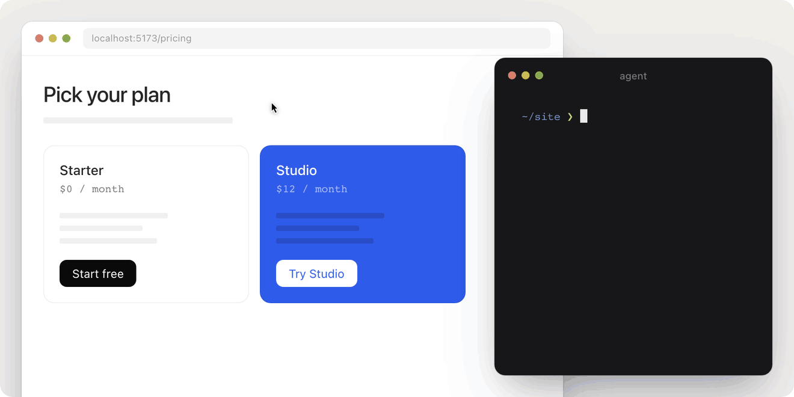

<h1 align="center">Annotation tool</h1>

<p align="center"><b>Point at anything on a page and tell your agent exactly what you mean.</b></p>

<p align="center">
  
</p>

I work on interfaces with coding agents every day. The slow part is explaining which thing I mean. "The button in the second card, no, the other one." So I built this layer for a project at work, and then kept missing it everywhere else.

Press Option+Shift+C, point at a block, click. You get one short line in your clipboard:

```
[1] Pick on src/Pricing.vue · Component: Card (./Card.vue), placed at ./Pricing.vue:4 · Text: "Starter"
```

Paste it into your message and keep talking. Talk, paste, talk, paste. The picks are numbered, so you can write "make [1] look like [2]" and the agent knows both. For me this works better than selecting an object in a tool, because the reference sits right inside the sentence.

Each pick has enough to find the thing and nothing to read past: the page, the name, the file and line, the text on it, the font.

## Add it to a project

Give your agent this link and say "add this to my project":

```
https://github.com/ryadovoys/annotation-tool
```

It follows [INSTALL.md](INSTALL.md), asks which highlight colour you want and puts the layer on top. It only runs in development and never reaches your users.

Or do it yourself. On a plain HTML page, add one line before `</body>`:

```html
<script src="https://cdn.jsdelivr.net/gh/ryadovoys/annotation-tool@1/annotation-tool.js"></script>
```

In a Vite project:

```bash
npm i -D github:ryadovoys/annotation-tool
```

```js
// vite.config.js, before the framework plugin
import annotationTool from "annotation-tool/vite";

plugins: [annotationTool(), vue()]
```

## How to use it

| Key | What it does |
| --- | --- |
| Option+Shift+C | Turn it on or off |
| W | Go up a layer, to the parent |
| S | Go down a layer, to the child |
| Click | Copy the reference and close |
| R | Start numbering from [1] again |
| Esc | Close without copying |

W and S work by key position, so they also work on a Russian keyboard. The number also starts over after 10 minutes of quiet.

## Colours

Yellow like a highlighter by default, because it stands out on almost any page. There are also `pink`, `mint` and `sky`, or use any hex:

```html
<script data-color="mint" src="..."></script>
```

```js
annotationTool({ color: "#ff6b00" })
```

## What it can see

| Where | What you get |
| --- | --- |
| Plain HTML on a local server | Element, file and line |
| Plain HTML opened as a file | Element and a CSS selector |
| Vue 3 with Vite | Component, its file, where it is placed, with lines |
| Vue 3 without the plugin | Component and its file, no lines |
| React with Vite | Component, where it is placed, with lines |
| Anything else in a browser | Element and a CSS selector |

I tested the first five on Vue 3.5, React 19 and Vite. It works in a browser, so a native iOS or macOS app is out of reach. Electron and Tauri apps are web pages inside, so it should work there too.

Try it yourself: open [demo/index.html](demo/index.html) through a local server.

## License

MIT
